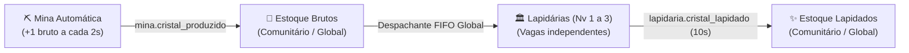
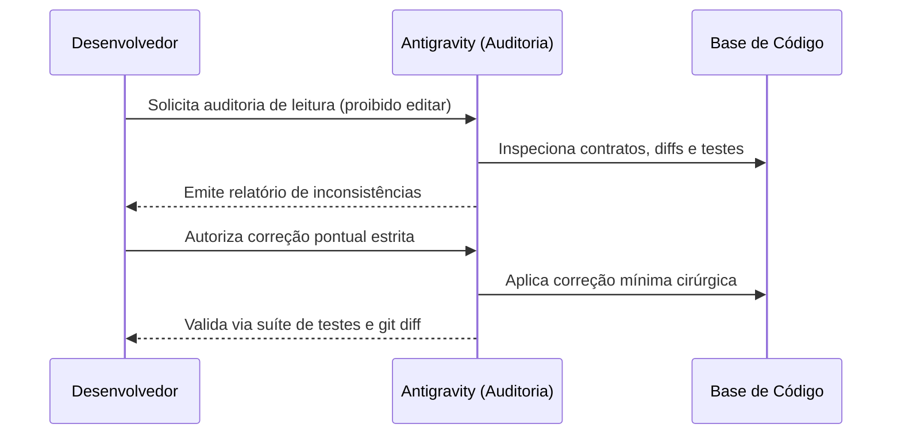

# Processo de Desenvolvimento — Vila dos Cristais

> **Registro Retrospectivo de Engenharia de Software**
> **Metodologia:** Desenvolvimento Orientado por Especificação (*Spec-Driven Development — SDD*) com Supervisão de Agentes de IA
> **Projeto:** Vila dos Cristais (Simulação Cooperativa em Tempo Real Orientada a Eventos)
> **Disciplina:** Linguagens e Paradigmas de Programação (LPP) — 2026
> **Autor / Integrante:** Leonardo Ávila

---

## 1. Introdução e Objetivo

O projeto **Vila dos Cristais** consiste em uma aplicação cooperativa em tempo real baseada no Paradigma Orientado a Eventos, construída com backend assíncrono em Python (`python-socketio`, `asyncio`, Uvicorn) e cliente web baseado em Vue 3 e Phaser 3. No ambiente simulado, participantes conectam-se assumindo os papéis de *Mestre* ou *Jogador*, cooperando na gestão comunitária de uma mina automatizada de cristais brutos e na construção, operação e melhoria de lapidárias para a produção de cristais lapidados.

O objetivo deste documento é **registrar retrospectivamente o processo de desenvolvimento do software**, apresentando de forma factual, técnica e rastreável como o projeto foi concebido, especificado, arquitetado, implementado, testado e evoluído.

Em vez de uma abordagem convencional baseada em codificação direta e assistida por IA via comandos pontuais e soltos, o projeto adotou um fluxo de trabalho estruturado, no qual **uma especificação funcional formal viva atuou como a referência central e fonte de verdade funcional do projeto**, orientando o planejamento técnico executivo, a divisão atômica de tarefas e a verificação contínua por suítes de testes automatizados e auditorias estáticas de código.

---

## 2. Abordagem Metodológica

### 2.1 O Desenvolvimento Orientado por Especificação (SDD) como Referência
O *Spec-Driven Development* (SDD) foi adotado neste projeto como a referência conceitual para estruturar o ciclo de desenvolvimento antes da codificação. Sob a perspectiva adotada neste trabalho, a abordagem caracteriza-se por quatro princípios fundamentais:
1. **Formalização Inicial:** As regras de negócio, limites invariantes e contratos de comunicação entre cliente e servidor são especificados previamente de forma rigorosa;
2. **Planejamento Arquitetural:** O desenho técnico de dados, concorrência e tarefas assíncronas é estruturado antes da codificação para atender à especificação;
3. **Execução Delimitada:** A implementação é dividida em tarefas incrementais, estritamente restritas pelo escopo definido nos artefatos prévios;
4. **Verificação Orientada por Requisitos:** Os testes automatizados e as validações manuais decorrem diretamente dos requisitos, cenários formais e contratos catalogados.

### 2.2 Distinção Metodológica: Práticas Compatíveis vs. GitHub Spec Kit
É fundamental estabelecer com clareza o enquadramento metodológico deste projeto:
- **O que foi adotado:** Práticas, princípios e padrões de trabalho conceitualmente compatíveis com os fundamentos do SDD (especificação prévia viva, plano técnico executivo, restrições negativas de escopo, passos incrementais e verificação contínua).
- **O que NÃO foi utilizado:** O projeto **não utilizou formalmente o GitHub Spec Kit**. Não foram instalados pacotes, extensões de linha de comando (`speckit CLI`), templates proprietários no diretório `.speckit/` ou comandos automatizados do framework. A decomposição das tarefas e a governança das etapas foram realizadas manualmente pelo desenvolvedor com apoio de prompts estruturados.

### 2.3 Comparação com o Desenvolvimento Baseado Exclusivamente em IA
Ao contrário de abordagens de implementação conduzidas exclusivamente por solicitações pontuais de código ou sem artefatos prévios de ancoragem, o processo da Vila dos Cristais manteve o uso da inteligência artificial sob **supervisão humana contínua e estruturada**:
- O desenvolvedor exerceu controle ativo sobre a definição de escopo, regras de negócio e validação;
- Os limites de atuação de cada intervenção foram explicitamente delimitados, reduzindo o risco de antecipação de etapas ou alterações em arquivos não autorizados;
- As decisões de domínio e arquitetura previamente aprovadas foram rigorosamente preservadas ao longo de toda a evolução;
- Cada entrega foi sistematicamente validada por testes automatizados e inspeção de *diffs* antes da criação de qualquer commit.

---

## 3. Definição do Problema e das Regras de Negócio

Antes da elaboração dos documentos formais, as decisões de domínio foram consolidadas no documento `docs/referencias/decisoes-cristais.md`, adaptando o kit didático original do professor (que simulava toras de madeira e serrarias) para a temática de extração e beneficiamento de cristais:



### Decisões Fundamentais Consolidadas
1. **Economia e Recursos:** Dois recursos globais, sem limites máximos de armazenamento (`brutos` e `lapidados`), compartilhados entre todos os participantes conectados.
2. **Ciclo de Vida da Temporada:** Três fases exclusivas (`aguardando`, `aberta`, `encerrada`). Apenas o Mestre pode iniciar ou encerrar a temporada.
3. **Mina de Cristais:** Opera de forma autônoma e periódica a cada 2 segundos, emitindo `mina.cristal_produzido` exclusivamente na fase `aberta`.
4. **Construção de Lapidárias:**
   - Duração fixa de 3 segundos;
   - Toda estrutura inicia no Nível 1;
   - Alocação automática no primeiro lote livre (`lote1` a `lote6`, limite máximo de 6 estruturas);
   - Ocupa imediatamente 1 trabalhador, que é liberado de forma autônoma ao término da obra;
   - Limite global estrito de 2 trabalhadores simultâneos (`0/2` a `2/2`). Se ambos estiverem em obra, novas solicitações são rejeitadas com o motivo `"Sem trabalhador livre"`;
   - *Modalidades de pagamento:* Inicialmente concebida com custo exclusivo de 5 cristais brutos, a construção evoluiu posteriormente (no commit `60de02e`) para oferecer duas modalidades de escolha explícita pelo jogador: **5 cristais brutos** ou **5 cristais lapidados**, mantendo a validação e débito atômicos no servidor sem conversão automática entre estoques.
5. **Melhorias de Nível:**
   - Podem ser solicitadas para lapidárias existentes até o Nível 3 (Nível 2: 10 lapidados, 2 vagas; Nível 3: 15 lapidados, 3 vagas);
   - Duram 3 segundos;
   - **Não consomem trabalhadores**;
   - Interrompem imediatamente qualquer lapidação ativa na estrutura, estornando os cristais brutos em processamento para o estoque global.
6. **Processamento e Política FIFO:**
   - Lapidação unitária por vaga de 10 segundos, convertendo 1 bruto em 1 lapidado;
   - Distribuição automática de insumos orientada por política FIFO global: a vaga ociosa há mais tempo (`disponivel_desde`) tem prioridade absoluta na recepção do próximo cristal bruto extraído; em caso de empate, a prioridade é desempatada sequencialmente pelo número do lote e da vaga.

A formalização prévia dessas regras contribuiu para reduzir ambiguidades conceituais que poderiam comprometer a arquitetura distribuída e orientada a eventos.

---

## 4. Elaboração da Especificação Funcional

Com as regras de domínio pacificadas, foi elaborado o documento central de engenharia: `docs/especificacao.md` (introduzido no commit `5a5c31d`).

A especificação atuou como a **referência central e fonte de verdade funcional** do projeto. Diferencia-se dos demais artefatos por seu papel específico: enquanto `docs/referencias/decisoes-cristais.md` registra as definições e motivações de domínio, e o artefato de arquitetura modela a execução técnica interna, a especificação formaliza os contratos, regras operacionais e comportamentos esperados do sistema.

### 4.1 Conteúdo Estruturado da Especificação
A especificação organizou-se rigorosamente em:
- **Definição de Entidades e Estados:** Transições de estado da vila e das lapidárias (`disponível`, `em construção`, `em melhoria`).
- **Catálogo Canônico de Eventos Socket.IO:** Mapeamento exato de **19 eventos**, especificando para cada um: número, nome, emissor, destinatário, finalidade, payload detalhado e efeito no estado da aplicação.
- **Quatro Cenários Formais de Teste (BDD):**
  - *Cenário 1:* Recusa de construção por saldo insuficiente;
  - *Cenário 2:* Linha do tempo sequencial completa (abertura, mineração contínua, construção e encadeamento automático da primeira lapidação);
  - *Cenário 3:* Disputa concorrente por recursos entre dois jogadores simultâneos com débito atômico de saldo e rejeição do segundo;
  - *Cenário 4:* Saturação e liberação do limite global de trabalhadores (`0/2` $\rightarrow$ `1/2` $\rightarrow$ `2/2` $\rightarrow$ recusa $\rightarrow$ `1/2` $\rightarrow$ `2/2`).

Esses quatro cenários BDD serviram como âncoras formais da especificação, enquanto a suíte automatizada do projeto implementou testes adicionais cobrindo unidade, integração, protocolo e regressão (totalizando 113 testes).

### 4.2 A Especificação como Contrato Vivo
Durante todo o ciclo de vida, a especificação funcionou como um contrato vivo: quando as regras econômicas evoluíram para incluir duas modalidades de construção (commit `60de02e`), a especificação foi atualizada em conjunto com o código e os testes, preservando a coerência documental.

---

## 5. Planejamento Arquitetural do Backend

Entre a homologação da especificação funcional e o início da codificação do servidor, o Antigravity elaborou o documento técnico executivo `arquitetura-backend.md` (1.016 linhas), mantido nos artefatos da sessão do assistente. Esse documento serviu como planejamento técnico detalhado anterior à implementação e não constituía um arquivo formalmente versionado na entrega final do repositório.

Esse artefato desempenhou o papel de **ponte entre os requisitos funcionais e a implementação concreta**, respondendo a como garantir consistência assíncrona sob o laço do Python `asyncio`.

```
┌──────────────────────────────────────────────────────────────┐
│                    docs/especificacao.md                     │
│               (O que o sistema deve fazer)                   │
└──────────────────────────────┬───────────────────────────────┘
                               │
                               ▼
┌──────────────────────────────────────────────────────────────┐
│                    arquitetura-backend.md                    │
│            (Como o sistema será estruturado no código)       │
│  - Modelo em memória              - Atomicidade no asyncio   │
│  - Invalidação por ciclo_id       - Two-Phase Dispatch FIFO  │
└──────────────────────────────┬───────────────────────────────┘
                               │
                               ▼
┌──────────────────────────────────────────────────────────────┐
│                   server.py & test_etapa*.py                 │
│                   (Implementação Executável)                 │
└──────────────────────────────────────────────────────────────┘
```

### 5.1 Decisões Arquiteturais Consolidadas no Artefato

1. **Concorrência Cooperativa e Atomicidade Delimitada no `asyncio`:**
   O modelo arquitetural do backend baseia-se na execução em um único processo Python com um único worker e um único laço de eventos (`uvicorn server:app`). Como a execução das corrotinas no `asyncio` é cooperativa, uma sequência de validações e mutações compartilhadas executada sem pontos de suspensão (`await`) entre suas operações não é intercalada por outra corrotina no mesmo laço de eventos.
   Essa estratégia permitiu proteger operações críticas — como a conferência de saldos, alocação de lotes e débito de recursos — sem a necessidade de locks explícitos, estritamente dentro das condições arquiteturais estabelecidas. Essa garantia não deve ser generalizada para ambientes com múltiplos processos, múltiplos workers do Uvicorn ou estado compartilhado distribuído.

2. **Invalidação de Tarefas Assíncronas por Identificador de Ciclo (`ciclo_id`):**
   Um dos maiores desafios era lidar com lapidações ativas de 10 segundos quando uma estrutura sofre melhoria ou a temporada é encerrada. A arquitetura estabeleceu o padrão de tokens de ciclo:
   - Ao iniciar a lapidação, a tarefa recebe o `ciclo_id` da vaga;
   - Ao sofrer interrupção, o servidor estorna imediatamente os insumos e incrementa `vaga["ciclo_id"] += 1`;
   - Quando a tarefa acorda de `await sio.sleep(10)`, compara seu token local com o da vaga. Ao notar a divergência, cancela-se silenciosamente, evitando créditos indevidos ou estornos duplicados.

3. **Despachante FIFO em Duas Fases (*Two-Phase Dispatch*):**
   Para evitar que a distribuição de recursos ficasse sujeita a descontinuidades assíncronas, o despachante foi separado em:
   - *Fase 1 (Síncrona — `_alocar_fifo`):* Localiza vagas prioritárias e muta o estado atomicamente;
   - *Fase 2 (Assíncrona):* Emite os eventos de rede e agenda as tarefas de lapidação em background.

4. **Sincronização Causal de Início e Término de Obras (`inicio_emitido`):**
   No Turno 22, identificou-se o risco de falha de rede na emissão de `construcao.iniciada` deixar a obra sem temporizador de conclusão. A arquitetura incorporou o uso de `asyncio.Event()` (`inicio_emitido`), no qual a tarefa de segundo plano dorme o tempo residual e aguarda a confirmação da tentativa de emissão antes de concluir a estrutura.

---

## 6. Decomposição e Implementação Incremental

O desenvolvimento seguiu a divisão de etapas preconizada pelo guia instrucional acadêmico, estruturando a evolução em commits atômicos rastreáveis:

| Etapa | Commit | Data Confirmada | Mensagem do Commit | Escopo Implementado |
| :---: | :---: | :---: | :--- | :--- |
| **0** | `583c494` | 2026-11-01 | `chore: estrutura inicial executavel` | Esqueleto ASGI, arquivos estáticos e assets da vila. |
| **1** | `06aa481` | 2026-11-01 | `feat: implementa conexao e sincronizacao da vila` | Autenticação, papéis (Mestre/Jogador) e `estado.sincronizado`. |
| **2** | `c24c505` | 2026-11-01 | `feat: implementa abertura e encerramento da vila` | Controle de temporada pelo Mestre e Mina autônoma a cada 2s. |
| **3** | `8fe7be7` | 2026-11-01 | `feat: implementa construcao das lapidarias` | Obras de 3s, ocupação de 1 trabalhador e limite global de 2. |
| **4** | `275f4d9` | 2026-11-01 | `feat: implementa processamento automatico das lapidarias` | Lapidação de 10s e despachante com política FIFO global. |
| **5** | `cc6e6d7` | 2026-11-01 | `feat: implementa melhorias das lapidarias` | Níveis 2 e 3, cancelamento com estorno e auto-recuperação. |
| **6.1** | `549a90e` | 2026-11-01 | `feat: integra conexão e sincronização inicial do cliente` | Tela de login, hidratação do Vue e captura de erros. |
| **6.2** | `ee97ee1` | 2026-11-01 | `feat: implementa controle de temporada no cliente` | Botões contextuais do Mestre e faixas visuais no Phaser. |
| **6.3** | `2cfc368` | 2026-11-01 | `feat: integra produção da mina no cliente` | Reatividade à extração da mina e filtro de timeline. |
| **6.4** | `501b57d` | 2026-11-01 | `feat: implementa construção de lapidárias no cliente` | Botão de construção, trava de pendência e animação de obra. |
| **6.5** | `eb45a25` | 2026-11-01 | `feat: implementa processamento e melhorias no cliente` | Cards de lapidárias, barras de progresso e correlação de ID. |
| **7** | `c7e9985` | 2026-11-01 | `feat: adiciona contadores de eventos no cliente` | Painel colaborativo de contadores por tipo de evento. |
| **8** | `721521c` | 2026-11-01 | `docs: finaliza documentacao e rodape para entrega` | Respostas conceituais no README e identificação acadêmica. |
| **Evolução** | `60de02e` | 2026-11-02 | `feat: adiciona construção com duas modalidades de pagamento` | Refinamento com 5 brutos ou 5 lapidados e fix de snapshot. |

A decomposição em pequenas etapas permitiu que cada nova funcionalidade fosse validada isoladamente antes do avanço para a etapa subsequente, contendo falhas em sua origem.

---

## 7. Engenharia de Prompts e Supervisão dos Agentes

A condução do agente de inteligência artificial (Antigravity) baseou-se em uma disciplina rigorosa de engenharia de prompts com restrições explícitas. Ao longo dos 81 turnos registrados no histórico de interação disponível, observou-se um padrão recorrente de instruções delimitadas por objetivos claros, escopo restrito, regras negativas e critérios objetivos de validação.

### 7.1 Padrões Estruturais de Comando
- **Auditoria de Leitura Precedente (*Read-Only*):** Em diferentes etapas, o desenvolvedor solicitou análises diagnósticas antes de autorizar intervenções.
- **Lista Branca de Arquivos (*Whitelisting*):** Proibição expressa de editar arquivos fora do escopo estrito da etapa.
- **Bloqueio de Antecipação (*Anti-Scope Creep*):** Proibição enfática de implementar funcionalidades pertencentes a etapas futuras.
- **Critérios Formais de Aceite:** Exigência de testes automatizados específicos para validar os comportamentos, fluxos de exceção e contratos previstos, acompanhados de verificação estática de diffs antes de qualquer aprovação.

---

### 7.2 Exemplos Literais do Histórico de Interação

#### Exemplo 1: Auditoria Inicial de Leitura (Turno 1)
- **Contexto:** Marco zero do repositório, antes de qualquer alteração física.
- **Objetivo:** Mapear o kit didático e requisitos oficiais sem produzir efeitos colaterais.
- **Trecho Literal:**
  ```text
  /plan Quero iniciar uma auditoria de leitura do projeto, sem modificar absolutamente nenhum arquivo.

  Leia e analise:
  1. Os documentos em `docs/referencias/`, especialmente o enunciado do trabalho e o guia de implementação do professor.
  2. O documento `docs/referencias/decisoes-cristais.md`, que contém as decisões já aprovadas para a nossa versão.
  3. A estrutura atual do projeto e o kit original dentro de `vila/`.

  Objetivos:
  - Identificar a estrutura real existente, sem presumir arquivos ou funcionalidades.
  - Comparar as decisões do projeto com os requisitos do professor.
  - Identificar o que já está implementado, o que falta implementar e possíveis incompatibilidades técnicas.
  - Apontar dúvidas e riscos que precisam ser resolvidos antes da implementação.

  REGRAS OBRIGATÓRIAS:
  - Não crie, edite, mova, renomeie ou exclua arquivos.
  - Não execute comandos que alterem o projeto.
  - Não instale dependências.
  - Não modifique o kit original.
  - Não invente requisitos ou etapas que não estejam nos documentos.
  - Quando apontar um requisito, indique o documento e a seção que o fundamentam.
  - Se não conseguir verificar algo, declare explicitamente.

  Entregue um relatório organizado com estrutura, estado atual, requisitos, pendências técnicas e dúvidas. Aguarde minha aprovação antes de qualquer ação posterior.
  ```
- **Supervisão Comprovada:** O desenvolvedor bloqueou intervenções precipitadas de código, forçando o alinhamento factual com os requisitos do professor antes de autorizar a escrita.

---

#### Exemplo 2: Criação Controlada da Especificação Formal (Turno 6)
- **Contexto:** Formalização do catálogo de eventos e cenários BDD.
- **Objetivo:** Autorizar unicamente a escrita de `docs/especificacao.md`.
- **Trecho Literal (Excerto):**
  ```text
  # Criação da especificação formal — Projeto Cristais

  A atualização de `docs/referencias/decisoes-cristais.md` foi concluída e revisada.

  Agora, quero criar a especificação formal do projeto no caminho:
  `/home/leona/lpp-trabalho01-leonardo-avila/docs/especificacao.md`

  Esta etapa autoriza exclusivamente a criação desse arquivo.

  ## 1. Leitura obrigatória antes da criação
  Leia integralmente os seguintes documentos:
  1. `docs/referencias/decisoes-cristais.md` — documento canônico com as decisões aprovadas do projeto Cristais.
  2. `docs/referencias/Trabalho_01_-_Programacao_Orientada_a_Eventos_2026_Simplificado.md` — enunciado oficial do professor.
  3. `docs/referencias/Guia_de_Implementacao_-_Vila_em_Tempo_Real.md` — guia oficial de implementação.

  Utilize os documentos oficiais para verificar os requisitos acadêmicos e o documento de decisões como fonte das regras específicas da temática.
  Não invente regras, requisitos, eventos ou comportamentos que não estejam fundamentados nesses documentos ou nas decisões expressamente aprovadas.
  Se encontrar contradições entre as fontes, não resolva silenciosamente. Registre a divergência e interrompa a criação se ela comprometer a especificação.
  ```
- **Supervisão Comprovada:** Proibição explícita de resolver contradições silenciosamente, assegurando a integridade conceitual do catálogo de eventos.

---

#### Exemplo 3: Correção Pré-Implementação no Documento de Arquitetura (Turno 22)
- **Contexto:** Quarta rodada de revisão de `arquitetura-backend.md`.
- **Objetivo:** Corrigir uma falha teórica de sincronização em tarefas assíncronas antes do código.
- **Trecho Literal (Excerto):**
  ```text
  Faça exclusivamente a correção do risco de uma obra ficar registrada como ativa sem que sua tarefa de segundo plano seja iniciada, no documento `arquitetura-backend.md`.

  **Não implemente código no projeto. Não altere `server.py`, `client/index.html` ou qualquer outro arquivo do projeto. Não modifique regras funcionais já aprovadas.**

  ### Problema identificado
  Em `solicitar_construcao()` e `solicitar_melhoria()`, o fluxo atual é:
  1. Alterar o estado e registrar a obra ativa.
  2. Executar `await sio.emit(...)`.
  3. Iniciar a tarefa com `sio.start_background_task(...)`.

  Se o `emit` falhar ou a corrotina for cancelada durante essa janela, a obra pode permanecer registrada como ativa sem uma tarefa responsável por concluí-la.

  ### Correção desejada
  Ajuste o fluxo para garantir que a tarefa de construção ou melhoria seja iniciada mesmo se a emissão do evento de início falhar.
  ```
- **Supervisão Comprovada:** O desenvolvedor identificou uma sutil janela de condição de corrida puramente na leitura do planejamento e exigiu a correção arquitetural prévia, evitando a injeção do defeito em produção.

---

#### Exemplo 4: Implementação com Bloqueio de Etapas Futuras (Turno 31)
- **Contexto:** Início da Etapa 4 (Processamento automático das lapidárias).
- **Objetivo:** Implementar lapidação e fila FIFO, proibindo expressamente melhorias de nível.
- **Trecho Literal (Excerto):**
  ```text
  Vamos iniciar a **Etapa 4 — Processamento Automático das Lapidárias** do projeto Vila dos Cristais.

  As Etapas 1, 2 e 3 estão implementadas, testadas e publicadas no GitHub. O último commit é `8fe7be7`.

  ## Objetivo
  Implementar o processamento automático de cristais nas lapidárias já construídas, respeitando integralmente a especificação aprovada.

  **Nesta etapa, não implementar melhorias de nível.** Elas serão desenvolvidas na Etapa 5, mas a implementação atual deve permitir que futuramente o processamento seja interrompido e retomado por uma melhoria.

  ## Regras funcionais
  1. Cada vaga livre de uma lapidária disponível pode processar um cristal bruto.
  2. Cada processamento dura exatamente 10 segundos, independentemente do nível da lapidária.
  3. Ao iniciar, consome um cristal bruto do estoque global.
  4. Ao concluir, adiciona um cristal lapidado ao estoque global.
  ...
  ```
- **Supervisão Comprovada:** Bloqueio ativo contra contaminação de escopo, garantindo a atomicidade pedagógica e técnica de cada commit.

---

#### Exemplo 5: Correção de Concorrência e Rastreabilidade por ID (Turno 60)
- **Contexto:** Auditoria de integração do cliente web na Etapa 6.5.
- **Objetivo:** Adicionar correlação unívoca em melhorias simultâneas entre dois jogadores.
- **Trecho Literal (Excerto):**
  ```text
  # Correção de concorrência — Correlação de solicitações de melhoria

  Implemente uma correção pontual no fluxo de melhorias das lapidárias do projeto Vila dos Cristais.

  ## 1. Problema identificado
  O evento `melhoria.iniciada` é transmitido por broadcast e não contém o solicitante nem um identificador da solicitação.
  Atualmente, o cliente libera `comandoMelhoriaPendente` ao receber qualquer `melhoria.iniciada`, permitindo que uma operação iniciada por outro jogador libere indevidamente a trava local.
  A comparação apenas por `lapidaria_id` não resolve completamente o problema: dois jogadores podem solicitar simultaneamente a melhoria da mesma lapidária.
  A correção deve permitir identificar precisamente qual resposta corresponde a cada solicitação.

  ## 2. Limites de atuação
  - Antes de editar, leia os trechos atuais de `server.py`, `client/index.html` e os testes relacionados.
  - Preserve todas as regras de negócio existentes.
  - Não altere a política de concorrência entre estruturas.
  - Não renomeie, remova ou adicione eventos ao catálogo.
  - Não faça refatorações gerais.
  - Não faça commit nem push.
  ```
- **Supervisão Comprovada:** Identificação de falha de concorrência de interface e especificação precisa da solução por correlação de identificadores (`solicitacao_id`).

---

### 7.3 Divisão de Responsabilidades
A cooperação no desenvolvimento baseou-se em papéis complementares e não sobrepostos:

| Participante | Atribuições e Responsabilidades Efetivamente Observadas |
| :--- | :--- |
| **Desenvolvedor Humano** | • Decisões de domínio, regras de negócio e limites de projeto.<br/>• Formulação dos prompts com limites negativos rígidos e aprovação formal.<br/>• Auditoria visual e validação manual com múltiplas abas no navegador.<br/>• Autoridade final sobre `git commit` e `git push`. |
| **ChatGPT** | • Apoio na discussão conceitual de regras e requisitos acadêmicos.<br/>• Auxílio na estruturação e refinamento dos prompts entregues ao Antigravity.<br/>• Apoio na fundamentação teórica sobre o paradigma reativo para o README. |
| **Antigravity** | • Inspeção estática de arquivos, dependências e código do repositório.<br/>• Elaboração do documento executivo `arquitetura-backend.md`.<br/>• Codificação incremental e geração de testes automatizados unitários e de integração.<br/>• Execução de comandos no terminal (`unittest`, `git diff --check`, `git status`). |

---

## 8. Testes e Validação

A qualidade da aplicação e a prevenção de regressões foram verificadas por uma abordagem multifacetada de validação contínua. Ao término do desenvolvimento, a suíte somava **113 testes automatizados** com **100% de aprovação**, contribuindo para atestar o comportamento esperado e reduzindo substancialmente o risco de inconsistências:

```
tests/
├── test_etapa1.py  (18 testes: conexão, autenticação, mestre único, snapshot)
├── test_etapa2.py  ( 8 testes: abertura/encerramento, mina 2s, recusas de fase)
├── test_etapa3.py  (15 testes: obras, trabalhadores 0/2 a 2/2, 2 modalidades)
├── test_etapa4.py  (11 testes: lapidação 10s, política FIFO global, estorno)
├── test_etapa5.py  (21 testes: melhorias, cancelamento, correlação de IDs)
├── test_etapa6.py  (32 testes: verificação estática de HTML e lógica Node.js)
└── test_etapa7.py  ( 8 testes: contadores de eventos recebidos/enviados)
```

### Estratégias de Teste Utilizadas
1. **Testes Assíncronos Unitários em Processo (`unittest.IsolatedAsyncioTestCase`):**
   Testam corrotinas do backend com injeção de dependências e tempo acelerado via `patch.object(server, 'TEMPO_OBRA', 0.03)`, executando centenas de asserções em frações de segundo.
2. **Testes de Integração de Protocolo (`ClienteEngineIO`):**
   Emulador de cliente Socket.IO em Python que realiza handshake e troca pacotes reais com a aplicação ASGI em porta dinâmica, inspecionando a ordem dos frames recebidos.
3. **Testes Comportamentais de Interface Isolados via Node.js:**
   Em vez de depender exclusivamente de testes manuais, `tests/test_etapa6.py` executa trechos isolados de JavaScript via `node -e "..."` em subprocessos Python, simulando e validando a lógica dos manipuladores Vue e Phaser (como travas locais de pendência `comandoConstrucaoPendente`, bloqueios contra cliques duplos e correlação de identificadores), sem constituir testes E2E completos de renderização de navegador.
4. **Verificações Estáticas de Formatação e Rastreabilidade:**
   Comando `git diff --check` executado obrigatoriamente antes de cada commit para impedir quebras de padrão e espaços em branco residuais.
5. **Validação Manual Interativa com Duas Abas:**
   Conforme registrado no README, o desenvolvedor validou visualmente no navegador o comportamento do mapa Phaser 3 em duas abas simultâneas (Mestre e Jogador), inspecionando animações de progresso, emissão de sons, atualização de cards e concorrência de cliques.

---

## 9. Auditorias, Correções e Evolução

O processo contou, em diferentes etapas, com **auditorias diagnósticas de leitura** antes da aplicação de correções pontuais:



### Exemplos Marcantes de Inconsistências Tratadas
- **Desarmamento Indevido de Trava em Melhoria:** Identificado na Etapa 6.5 que uma `melhoria.iniciada` de Alice liberava a trava de Bob na mesma estrutura. Corrigido com a introdução do campo `solicitacao_id` gerado via `crypto.randomUUID()`.
- **String de Situação da Lapidária no Phaser:** Na auditoria final, identificou-se que o cliente checava `lap.situacao === "em_construcao"`, enquanto o servidor enviava `"em construção"`, causando a renderização prematura de lapidárias completas durante reconexões em meio a obras. Alinhado para `"em construção"` com teste de regressão em Node.js (`test_32`).
- **Ocultação da Faixa no Phaser:** Correção no listener `vila.aberta` para invocar `faixa.setVisible(false)` e ocultar o aviso "Aguardando o Mestre".
- **Evolução Econômica Pós-Entrega:** Introdução das duas opções de pagamento para novas lapidárias (5 cristais brutos ou 5 cristais lapidados), com validação atômica de saldo no servidor e reformulação da interface para dois botões diretos, mantendo intactos o limite de trabalhadores e a estabilidade da suíte.

---

## 10. Versionamento e Rastreabilidade no Git

O histórico do repositório espelha com fidelidade a decomposição de tarefas. O histórico de commits é estritamente linear, sem commits de mesclagem (*merges*), permitindo rastrear com clareza cada incremento:

```text
5a5c31d docs: especificação da vila
583c494 chore: estrutura inicial executavel
06aa481 feat: implementa conexao e sincronizacao da vila
c24c505 feat: implementa abertura e encerramento da vila
8fe7be7 feat: implementa construcao das lapidarias
275f4d9 feat: implementa processamento automatico das lapidarias
cc6e6d7 feat: implementa melhorias das lapidarias
549a90e feat: integra conexão e sincronização inicial do cliente
ee97ee1 feat: implementa controle de temporada no cliente
2cfc368 feat: integra produção da mina no cliente
501b57d feat: implementa construção de lapidárias no cliente
eb45a25 feat: implementa processamento e melhorias no cliente
c7e9985 feat: adiciona contadores de eventos no cliente
721521c docs: finaliza documentacao e rodape para entrega
60de02e feat: adiciona construção com duas modalidades de pagamento
```

- Os commits de implementação das Etapas 1 a 7 e o commit de refinamento pós-entrega acompanharam a criação ou atualização de suas respectivas suítes de teste (enquanto commits de especificação e documentação acadêmica focaram em artefatos textuais e de interface);
- Commits atômicos e focados facilitaram a auditoria isolada de diffs e a rastreabilidade conceitual de cada intervenção.

---

## 11. Correspondência com Princípios de Spec-Driven Development

A tabela a seguir consolida a correspondência conceitual entre as práticas efetivamente aplicadas no projeto e as fases do SDD, ressaltando que se trata de um mapeamento comparativo, e não de conformidade oficial com a ferramenta GitHub Spec Kit:

| Princípio SDD | Aplicação Efetiva no Projeto | Artefato Comprobatório | Grau de Correspondência |
| :--- | :--- | :--- | :--- |
| **Constitution** | Fixação de regras fundamentais e restrições de arquitetura imutáveis (concorrência mono-processo, economia de cristais, vocabulário). | `docs/referencias/decisoes-cristais.md` e `docs/referencias/Trabalho_01...` no commit `5a5c31d`. | **Correspondência conceitual:** Princípios não negociáveis que orientaram toda a governança. |
| **Specify** | Formalização exaustiva das regras, catálogo dos 19 eventos e 4 cenários BDD antes da codificação. | `docs/especificacao.md` no commit `5a5c31d` e mantida em sincronia até `60de02e`. | **Aplicação direta:** Especificação viva atuando como referência central e fonte da verdade funcional. |
| **Plan** | Documento executivo detalhando estruturas em memória, ciclo de vida de tarefas e controle de concorrência. | `arquitetura-backend.md` (1.016 linhas) gerado e revisado iterativamente antes da Etapa 1. | **Adaptação prática:** Elaboração manual de plano executivo detalhado em vez de ferramenta automatizada. |
| **Tasks** | Quebra sequencial em etapas atômicas orientadas pelo guia instrucional e executadas via prompts. | `docs/referencias/Guia_de_Implementacao_-_Vila_em_Tempo_Real.md` e prompts isolados por etapa. | **Adaptação prática:** Roteiro instrucional adotado como backlog executivo pelo desenvolvedor. |
| **Implement** | Codificação incremental de escopo fechado orientada a contratos, sem adiantar etapas futuras. | Commits isolados com padrão Conventional Commits (`feat: implementa...`). | **Aplicação incremental:** Código escrito em blocos incrementais validados passo a passo. |
| **Verify** | A verificação contínua combinou cenários da especificação com testes adicionais de unidade, integração, contrato e regressão. | 113 testes em `tests/` e conferências rotineiras de `git diff --check`. | **Adaptação prática:** Verificação contínua combinando cenários formais e testes adicionais. |

---

## 12. Limitações e Considerações Finais

### 12.1 Limitações Documentais e Metodológicas
1. **Ausência do Framework Oficial Spec Kit:** O projeto adotou a filosofia do SDD, mas não utilizou ferramentas proprietárias ou linhas de comando do GitHub Spec Kit. A governança foi conduzida pelo desenvolvedor via engenharia de prompts.
2. **Histórico Local do ChatGPT:** Os diálogos externos com o ChatGPT ocorreram no ambiente web da ferramenta e não deixaram logs físicos no repositório Git, sendo seu uso atestado através da declaração no `README.md` e do estilo homogêneo de estruturação dos comandos submetidos ao Antigravity.
3. **Validação E2E no Navegador:** A interface gráfica do Phaser 3 e as rotinas de áudio foram verificadas por testes comportamentais em Node.js e validação manual interativa, não tendo sido empregados frameworks como Cypress ou Playwright.

### 12.2 Avaliação do Processo
A experiência de desenvolvimento da Vila dos Cristais demonstrou que a especificação formal prévia e o planejamento arquitetural técnico constituem práticas de alto valor na engenharia de software assistida por inteligência artificial. A imposição de restrições explícitas de escopo, a delimitação de arquivos autorizados e a validação contínua por testes automatizados contribuíram significativamente para mitigar desvios de escopo (*drift*), identificar inconsistências de concorrência precocemente e manter o sistema alinhado aos princípios acadêmicos da Programação Orientada a Eventos.
